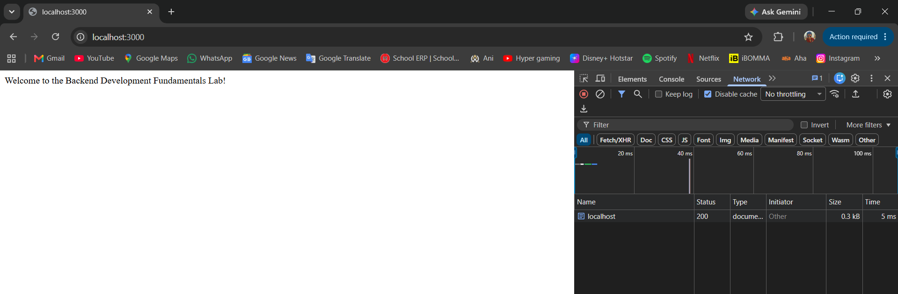
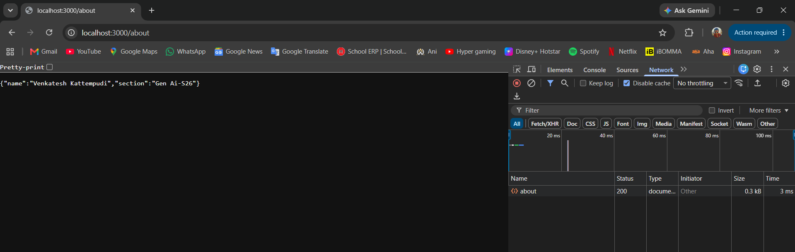
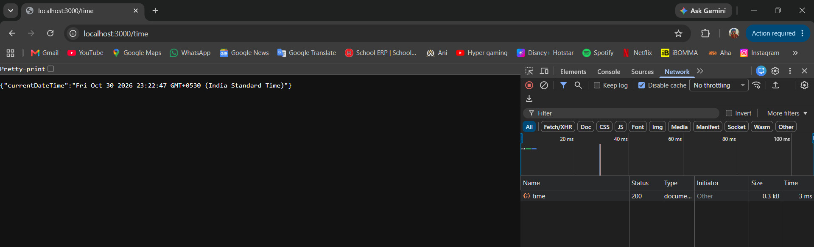
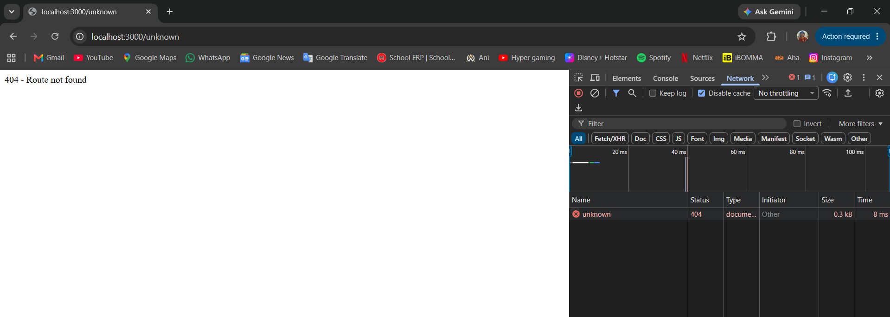

# Backend Development Fundamentals - Lab 1

## Student Details

- **Name:** Venkatesh Kattempudi
- **Section:** Gen Ai-S26
- **Registration Number:** YOUR_REGISTRATION_NUMBER

## 1. Objective

To create a basic HTTP server using Node.js and develop a web server using Express.js. Implement different GET routes and handle invalid routes using HTTP status codes.

## 2. Technologies Used

- Node.js
- Express.js
- JavaScript
- Visual Studio Code
- Git and GitHub

## 3. Project Setup

Clone or download the repository.

Navigate to the lab folder:

```bash
cd lab-01
```

Install dependencies:

```bash
npm install
```

## 4. Running the Servers

### Node.js HTTP Server

```bash
node http-server.js
```

Open: http://localhost:3000

### Express Server

```bash
node server.js
```

Open: http://localhost:3000

## 5. API Endpoints

| Method | Endpoint | Description | Status |
|---|---|---|---|
| GET | / | Displays welcome message | 200 OK |
| GET | /about | Returns student details in JSON | 200 OK |
| GET | /time | Returns current date and time in JSON | 200 OK |
| GET | /unknown | Handles unknown routes | 404 Not Found |

## 6. Screenshots

### Home Route



### About Route



### Time Route



### 404 Not Found



## 7. Deployment

**Live Application:** https://bdf-lab-01.onrender.com/

## 8. Result

Successfully created and tested a Node.js HTTP server and an Express.js server with multiple GET endpoints and 404 error handling.
