# Lab 3: REST API, Query Parameters, Validation and Debugging

## Student Details
- Name: Venkatesh Kattempudi
- Registration Number: 252U1R9168
- Section: Gen Ai-S26
- Subject: Backend Development Fundamentals

## GitHub Repository
https://github.com/Venkat9757/BACKEND-LAB-1

## Objective
To develop a REST API for managing books using Node.js, Express.js and SQLite, including search, sorting, pagination, price filtering, validation and CRUD operations.

## Technologies Used
- Node.js
- Express.js
- SQLite
- better-sqlite3
- Postman

## Installation and Execution
1. Open the lab-03 folder in the terminal.
2. Install dependencies using: npm install
3. Start the server using: node server.js
4. Server URL: http://localhost:3000

The SQLite database is created automatically when the server starts.

## API Endpoints
| Method | Endpoint | Description |
|---|---|---|
| GET | /books | Get all books |
| GET | /books?search_q=Atomic | Search books by title |
| GET | /books?order_by=price&order=DESC | Sort books |
| GET | /books?limit=2&offset=0 | Paginate books |
| GET | /books?min_price=300&max_price=600 | Filter by price |
| GET | /books/:id | Get a book by ID |
| POST | /books | Add a book |
| PUT | /books/:id | Update a book |
| DELETE | /books/:id | Delete a book |

## Status Codes and Validation
- 200 OK: Successful retrieval, update or deletion.
- 201 Created: Book successfully added.
- 400 Bad Request: Invalid input or query parameter.
- 404 Not Found: Requested book does not exist.

## Screenshots
### 01. Get All Books
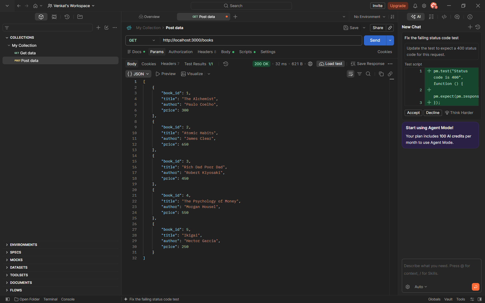

### 02. Search Books
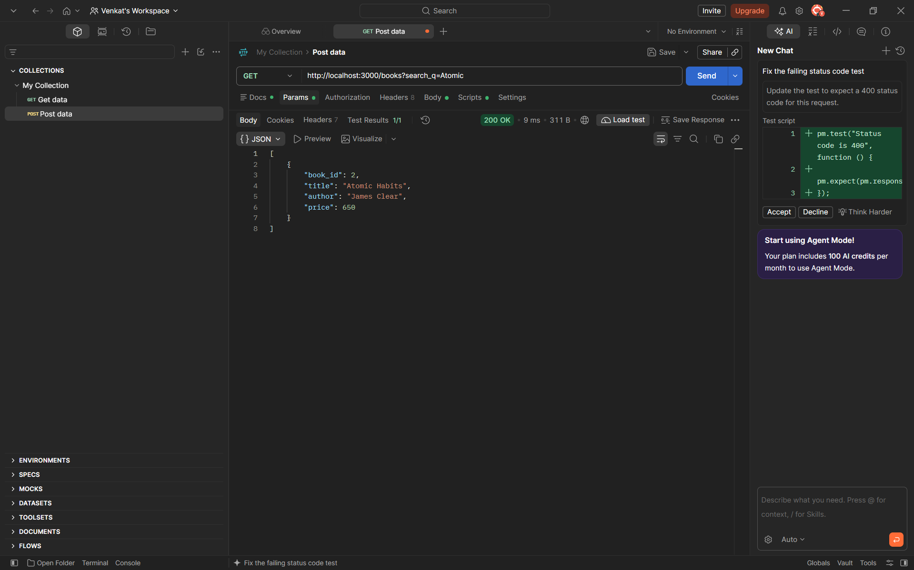

### 03. Sorting
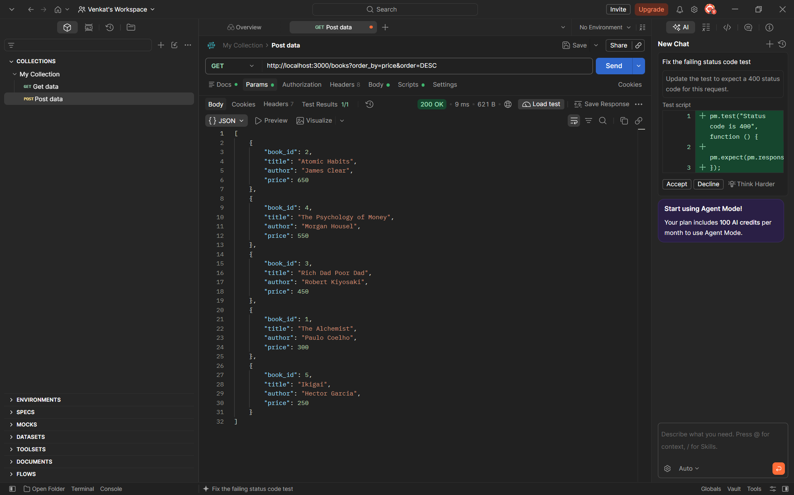

### 04. Pagination
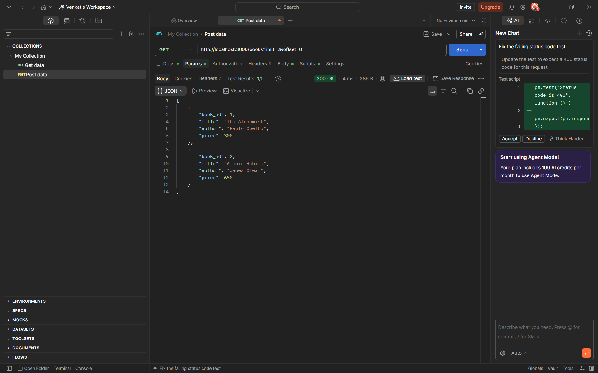

### 05. Price Filter
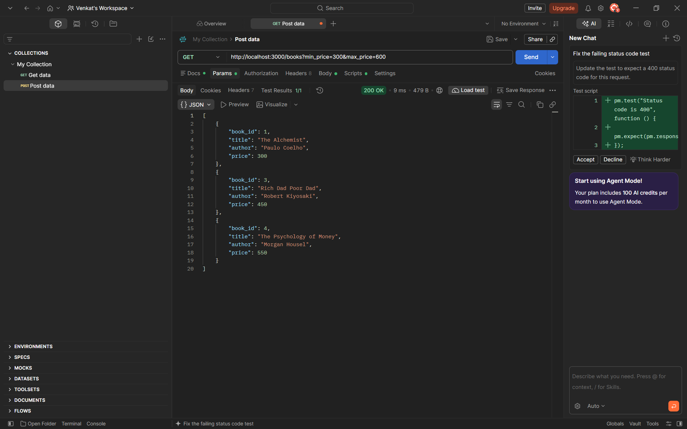

### 06. Get Book by ID

### 07. POST Success
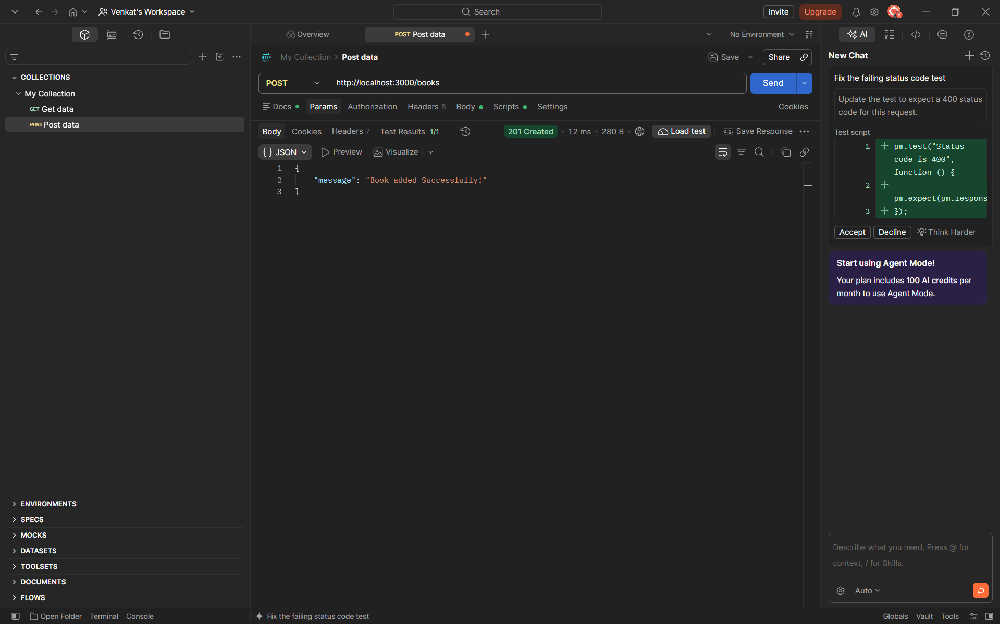

### 08. POST Validation Error
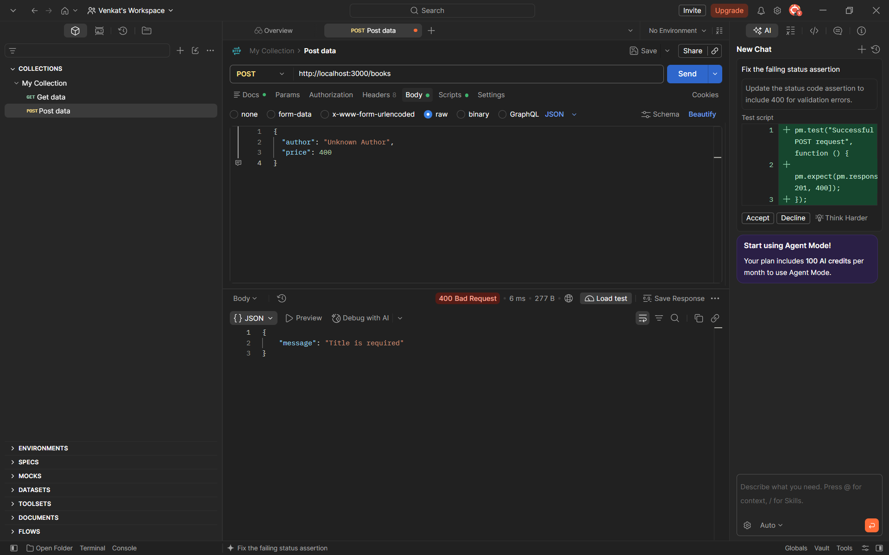

### 09. PUT Success
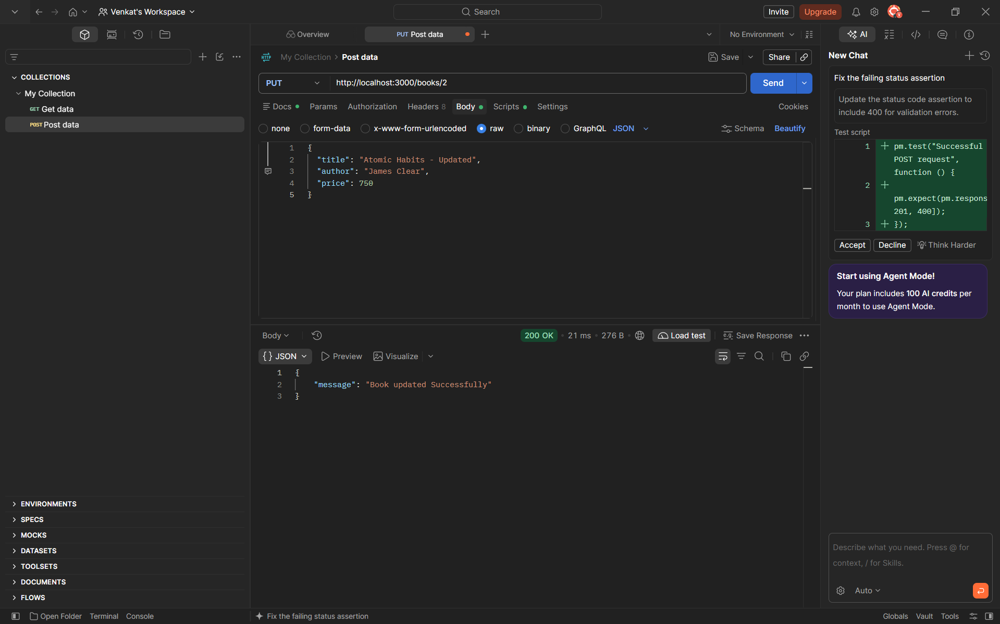

### 10. DELETE Success
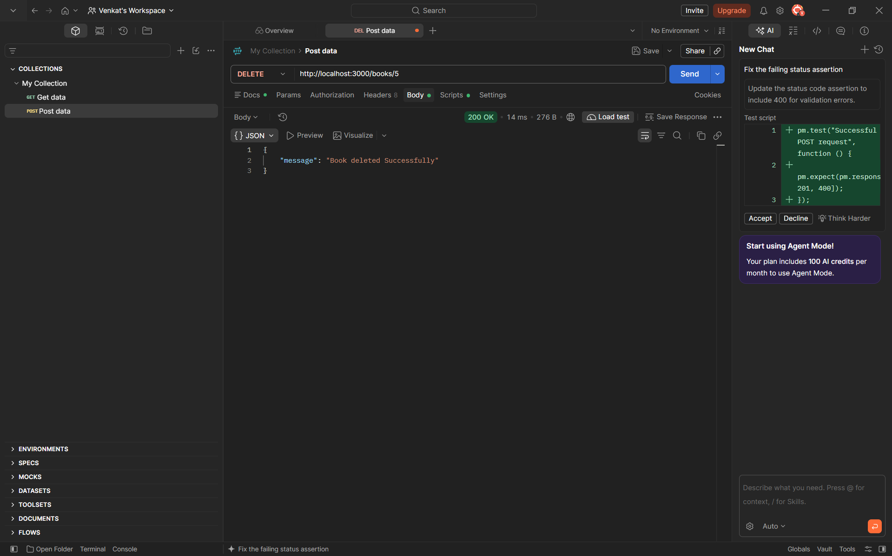

### 11. Not Found Error
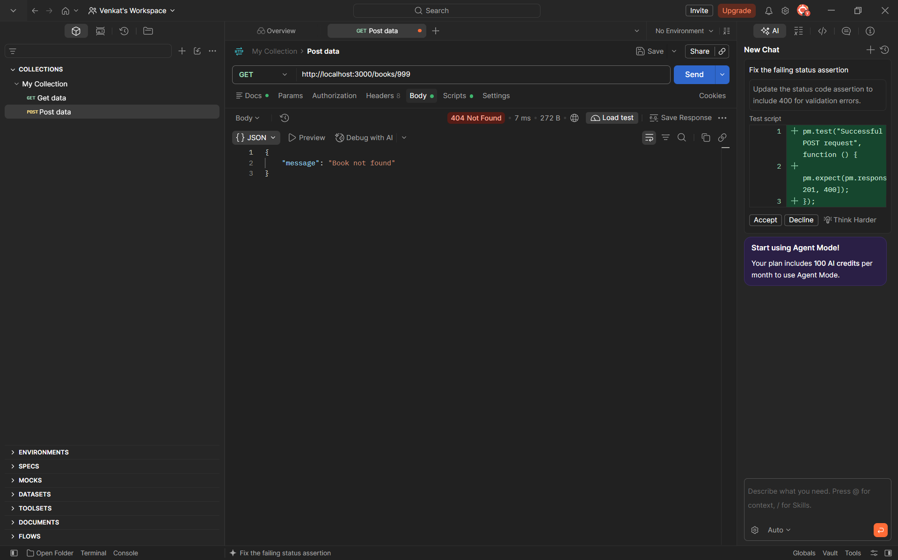

### 12. Query Validation
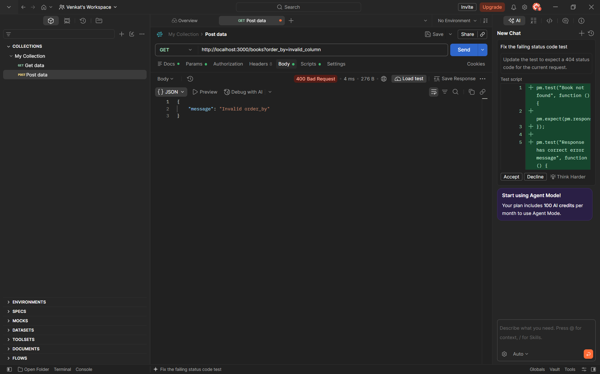

## Result
The REST API was implemented and tested using Postman. Search, sorting, pagination, price filtering, CRUD operations and validation responses were tested.
